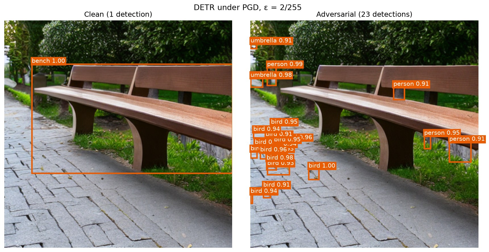
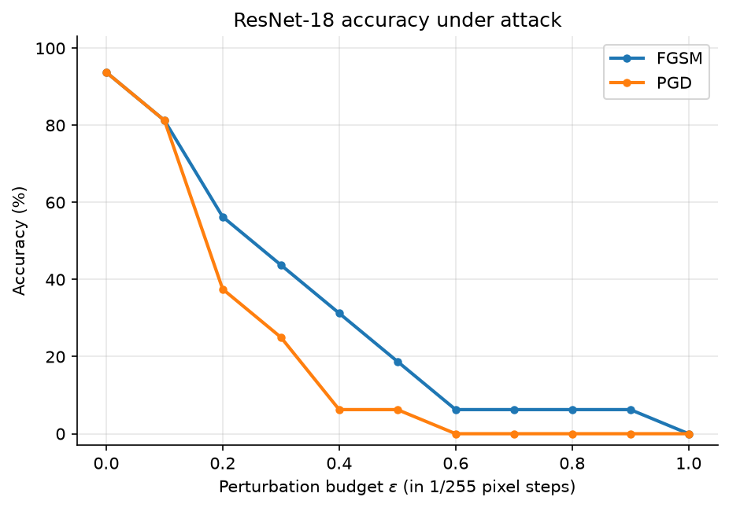
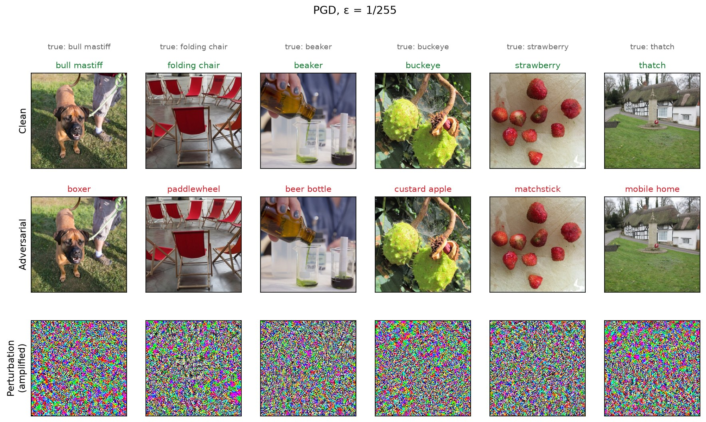
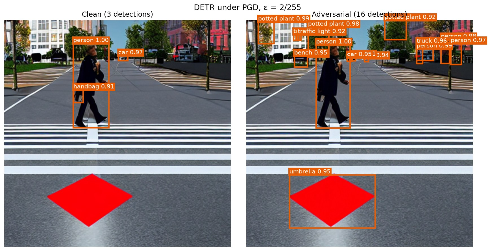
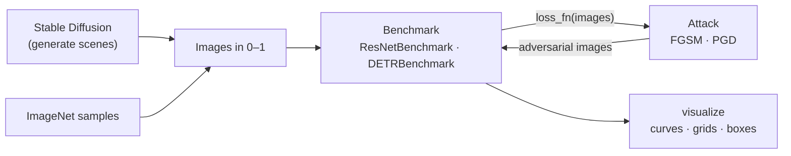

<div align="center">

# Gen-Attack

**Benchmarking adversarial attacks against image classifiers and object detectors.**

[](https://github.com/alicemuzum/gen-attack/actions/workflows/ci.yml)


[](LICENSE)
[](https://github.com/astral-sh/ruff)



*A change of at most 2/255 per pixel, invisible to a person, makes DETR lose the bench and see 23 objects that are not there.*

</div>

## Overview

Deep vision models can be fooled by small, carefully chosen changes to their input. Gen-Attack implements the standard gradient-based attacks and measures how much they degrade:

- **ResNet-18**, an ImageNet classifier: accuracy as a function of the perturbation budget ε.
- **DETR**, a transformer-based object detector: how detections change on a single scene.

The attacks are model-agnostic. Each one receives a *loss function* rather than a model, so the same FGSM and PGD code attacks a classifier through cross-entropy and a detector through DETR's Hungarian-matched set loss. Test scenes can be generated with **Stable Diffusion** and labelled with **Grounding DINO**, which removes the need for a hand-annotated dataset.

## Results

### Image classification: ResNet-18 on ImageNet

<p align="center">
  
</p>

| ε (×1/255) | 0 | 0.1 | 0.2 | 0.3 | 0.4 | 0.5 | 0.6 | 1.0 |
|---|---|---|---|---|---|---|---|---|
| **FGSM** | 93.8% | 81.3% | 56.3% | 43.8% | 31.3% | 18.8% | 6.3% | 0.0% |
| **PGD-10** | 93.8% | 81.3% | 37.5% | 25.0% | 6.3% | 6.3% | 0.0% | 0.0% |

Under both attacks an undefended ResNet-18 drops to 0% accuracy at ε = 1/255, which changes each pixel by at most one 8-bit intensity level. PGD, which takes ten projected steps instead of one, is consistently stronger than FGSM at the same budget.

<p align="center">
  
</p>

*Top: clean predictions. Middle: predictions after PGD with ε = 1/255. Bottom: the perturbation, amplified to be visible. Green means correct and red means wrong.*

### Object detection: DETR (ResNet-50)

<p align="center">
  
</p>

The detector has no ground-truth labels to attack against, so its own confident predictions on the clean image serve as targets and the attack maximises DETR's loss with respect to them. Even at ε = 2/255 the real objects are lost and the scene fills with confident false detections.

> These results come from the 16 ImageNet validation images bundled with Foolbox and from two generated scenes. They illustrate the methods; they are not a full-scale benchmark.

## Methods

| Attack | Update rule | Reference |
|---|---|---|
| **FGSM** | $x_{adv} = \text{clip}_{[0,1]}\big(x + \epsilon \cdot \text{sign}(\nabla_x \mathcal{L}(x))\big)$ | [Goodfellow et al., 2015](https://arxiv.org/abs/1412.6572) |
| **PGD** | $x_{t+1} = \Pi_{\lVert x' - x \rVert_\infty \le \epsilon}\big(x_t + \alpha \cdot \text{sign}(\nabla_x \mathcal{L}(x_t))\big)$, random start | [Madry et al., 2018](https://arxiv.org/abs/1706.06083) |

Both attacks are untargeted and bounded in L∞. All epsilons are in [0, 1] pixel units. Each model normalises its input internally, so a perturbation of ε means exactly ε change in the image a person would see.

## Quickstart

```bash
git clone https://github.com/alicemuzum/gen-attack.git
cd gen-attack
poetry install                 # or: pip install -e .
```

Reproduce the figures above (each run takes about a minute on a laptop CPU, and model weights download on first use):

```bash
gen-attack classify                                    # ResNet-18 robustness curve, FGSM and PGD
gen-attack detect --image assets/examples/bench.png    # DETR before and after PGD
gen-attack detect --attack fgsm --epsilon 0.01         # choose the attack and the budget
```

Figures are written to `results/`. Run `gen-attack <command> --help` to see all options.

Generating new test scenes needs the optional diffusion dependencies and, in practice, a GPU:

```bash
poetry install --extras generation
gen-attack generate "a crosswalk on a city street, realistic" --output scenes/crosswalk.png
```

### Docker

```bash
docker compose run --rm cpu classify
docker compose run --rm gpu detect --attack pgd    # requires the NVIDIA Container Toolkit
```

### Python API

```python
from PIL import Image
from gen_attack.attacks import get_attack
from gen_attack.models import DETRBenchmark, ResNetBenchmark

resnet = ResNetBenchmark()
images, labels = resnet.load_samples(16)
curve = resnet.robustness_curve("pgd", [0, 0.5 / 255, 1 / 255], images, labels, steps=10)

detr = DETRBenchmark(threshold=0.9)
result = detr.attack(Image.open("assets/examples/bench.png"), get_attack("fgsm", epsilon=2 / 255))
print(result.clean_detections.summary(), "->", result.adversarial_detections.summary())
```

## Architecture



```
src/gen_attack/
├── attacks/        Attack base class, FGSM, PGD, and a name → class registry
├── models/         ResNetBenchmark (classification), DETRBenchmark (detection)
├── generation/     Stable Diffusion generator, Grounding DINO open-vocabulary detector
├── visualize.py    Result figures
└── cli.py          The `gen-attack` command
tests/              CPU-only unit tests for the attacks and the CLI
notebooks/          The original exploratory notebooks
assets/             Example scenes and the figures in this README
```

### Adding an attack

Subclass `Attack`, implement `perturb`, and register the class under a name. It then works with every benchmark and appears in the CLI automatically:

```python
from gen_attack.attacks import Attack, register_attack


@register_attack("my-attack")
class MyAttack(Attack):
    def perturb(self, images, loss_fn):
        grad = self._loss_gradient(images, loss_fn)
        return (images + self.epsilon * grad.sign()).clamp(self.clip_min, self.clip_max)
```

## Development

```bash
poetry install --with dev
pytest                       # unit tests, CPU only, no model downloads
ruff check . && ruff format --check .
pre-commit install           # run the same checks on every commit
```

## Roadmap

- [x] FGSM and PGD attacks with a shared, model-agnostic interface
- [x] Classification (ResNet-18) and detection (DETR) benchmarks
- [x] Scene generation with Stable Diffusion and labelling with Grounding DINO
- [ ] Attack Grounding DINO directly (open-vocabulary detection)
- [ ] More attacks: Carlini & Wagner, MI-FGSM, and the AutoAttack ensemble
- [ ] A detection metric (mAP under attack) computed over a generated dataset
- [ ] Adversarial training as a baseline defence

## License

[MIT](LICENSE)
